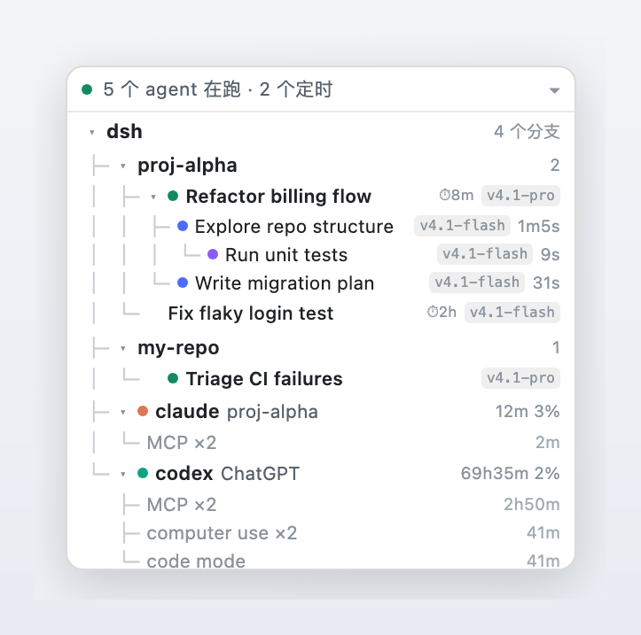

# Agent Tree · a mini live tree of every DSH agent

[简体中文](README.md) · English



**Agent Tree** is a small observability plugin for the DeepSeek Harness (DSH) Web UI: a **288px wide floating card**
in a corner that draws `dsh → workspace → conversation → subagent → grandchild` as a live tree with
`git log --graph`-style connectors. Only branches that are **running or scheduled** are shown, so the card stays small;
when nothing is happening it collapses to a one-line strip — and it never disappears.

It solves one concrete annoyance: with many conversations open you have to click into each one to see what its
subagents are doing. The DSH sidebar lists conversations, not agent lineage. This card shows **who is running,
at which depth, on which model, for how long, and when its next scheduled run fires**.

## Features

- **Real tree with git-style connectors** — root `dsh` (this instance) → `workspace` → `conversation` → `subagent` → grandchild, with `├─ └─ │` indentation per depth and `▾ / ▸` collapse.
- **Always-on entry** — idle collapses to `● Agent tree ▸`; work re-expands it; manual collapse wins.
- **Color = depth** — green dot for top-level conversations, blue for level-2 subagents, violet for deeper ones, grey for finished rows.
- **Per-row model chip** (right aligned) — from the session projection `modelSelection` (`next` → `lastUsed`), shortened to `v4.1-flash`; subagents without their own record inherit the parent's (tooltip says so).
- **Scheduled-task countdown** — reads `schedule.catalog()` from Automation tasks; sessions driven by a schedule are listed even while idle, with `⏱8m / ⏱2h / ⏱3d` and a `N running · M scheduled` headline.
- **Local external agent processes, also as a tree** — the plugin's host half exposes a read-only endpoint that finds running **claude / codex CLIs** via `ps` + `lsof` and nests their children by `ppid` (e.g. codex's `computer use ×4` / `MCP ×3` / `code mode`). They hang under `dsh` as **siblings of workspaces**, with the same row spec, and collapse like any branch. ChatGPT desktop's `Codex Framework` helpers are not mistaken for CLIs themselves.
- **Click to jump** — `subagentAddress()` + `uiWorkspace.openSession()`, including subagents.
- **Draggable, remembers its position** — stored in `localStorage`.

## Install in 3 minutes

Prerequisites: Node.js `^22.19 or ≥ 24` (same as the DSH runtime), pnpm 10+, DSH `≥ 0.2.1-rc.2 < 0.3` (verified on `0.2.1-rc.2`).

```sh
# 1) a dedicated profile (or reuse your existing web profile)
dsh --profile agent-tree --from-default-profile web

# 2) install from npm
dsh plugin --profile agent-tree add dsh-plugin-agent-tree

# 3) start
dsh --profile agent-tree --port 13090
```

**Restart `dsh` once after installing** (the host half registers the process endpoint), then hard-refresh the browser (`Cmd/Ctrl + Shift + R`).

```sh
# existing profile
dsh plugin --profile web add dsh-plugin-agent-tree
# from GitHub source
dsh plugin --profile web add "github:yuna78/dsh-agent-tree"
# local development
dsh plugin --profile web add "$PWD"
```

> Details, uninstall and troubleshooting: [docs/install.en.md](docs/install.en.md). What every element means: [docs/manual.en.md](docs/manual.en.md).

## Reading the card

| What you see | Meaning |
|---|---|
| `● 5 个 agent 在跑 · 2 个定时` | 5 sessions/subagents are running; 2 more are schedule-driven (may be idle right now) |
| `▾ dsh  4 个分支` | root node: this DSH instance, branch count on the right (workspaces + external agents) |
| `├─ ▾ proj-alpha  2` | workspace group, count on the right |
| `├─ ▾ ● Refactor billing flow  ⏱8m  v4.1-pro` | top-level conversation running (green), next scheduled run in 8 min, on v4.1-pro |
| `│  ├─ ● Explore repo structure  v4.1-flash  1m5s` | its subagent (blue), running for 1m05s |
| `│  │  └─ ● Run unit tests  v4.1-flash  9s` | grandchild agent (violet) |
| `├─ ● claude  proj-alpha        12m 3%` | a local claude CLI process in `proj-alpha`, 12 min, 3% CPU |
| `会话 6 · 子代理 3 · 运行中 5（live）` | self-check line: sessions / subagents / running; `live` = official realtime status stream |

The UI strings are Chinese for now (DSH itself is Chinese-first); a locale pass is welcome — the copy lives in one
`labels` object in `client.js`.

Click a row to jump to that session; drag the header to move the card; click `▾/▸` to collapse.

## Where the data comes from

Only public client-side UI contracts — no host patching, no database access:

| Info | Source |
|---|---|
| sessions + parent/child | `useSessions()` → `ids / byId` (`parentId`, `origin`) |
| live running state | `useSessionStatus()`; falls back to polling + `$on('api-session/status')` |
| workspace ownership | `ctx.workspaces.list.getSnapshot()` |
| duration / model | `projectionValues.subagentTiming`, `projectionValues.modelSelection` |
| scheduled tasks | `ctx.remote.schedule.catalog()` + `$on('schedule/changed')` |
| jumping | `ctx.sessions.subagentAddress()` + `ctx.uiWorkspace.openSession()` |
| external processes | host half: `GET /local/dsh-agent-tree/processes` |

## External process monitoring: scope and limits

- **Read-only**: `ps -axo pid=,etime=,pcpu=,command=` + `lsof -a -p <pid> -d cwd -Fn`. No signals, no output capture.
- **Real CLIs only**: the executable basename must be exactly `claude` or `codex`; ChatGPT desktop helper processes are excluded.
- **Endpoint guards**: same-origin, reuses DSH connection auth (401 without a session), GET only (405 otherwise), timeouts on `ps`/`lsof`, 3s cache, max 8 rows; if the `webServer` service is missing it only warns and never blocks DSH startup.
- **Platforms**: macOS / Linux. On Windows the block stays empty (the tree itself still works).
- Disable it by removing the plugin from the profile — the client card simply loses that section.

## Compatibility

| Item | Range |
|---|---|
| DSH | `>= 0.2.1-rc.2 < 0.3.0` (verified `0.2.1-rc.2`, Web profile) |
| Node.js | `^22.19.0 \|\| >= 24.0.0` |
| Platform | DSH Web (client seat `shell.overlay`); process block macOS/Linux |

## Development

```sh
npm test                              # unit tests (tree / model / schedule / process parsing)
npm run verify                        # package contract + seats + data sources + privacy + tests
node scripts/build-public-bundle.mjs  # whitelisted public copy with a privacy scan
```

Editing `client.js` needs only a hard refresh; editing `index.js` (host half) needs a `dsh` restart.

## License

[MIT](LICENSE)
